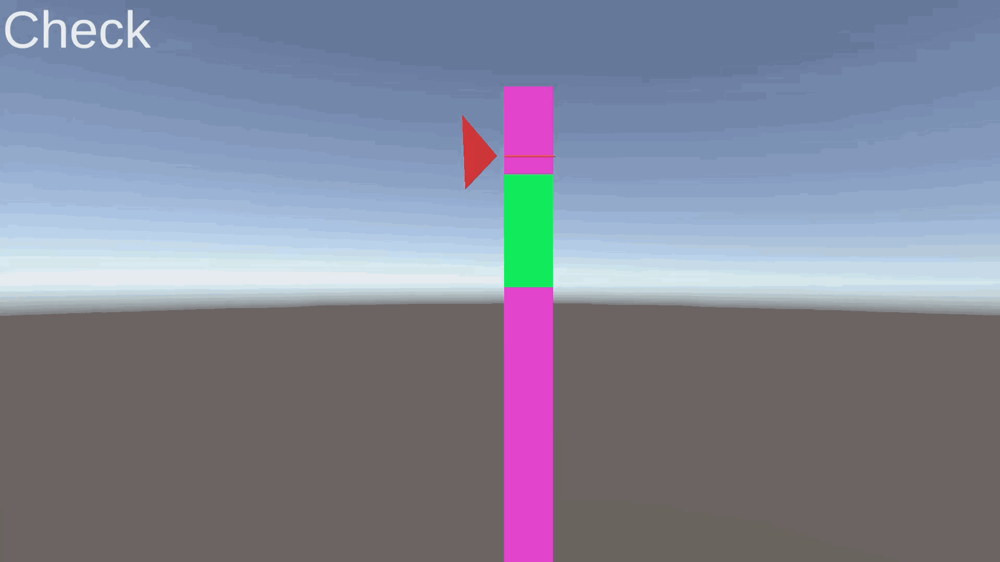

# はじめに
プログラムワークショップIVの管理用です

# 結果画像

- 工夫した点：シェーダーのTimeを変数にすることで、時間をMonoBehaviourScriptから渡すようにしました。また、シェーダーと同じ計算式を C# 側でも再現することで、判定ラインの位置が今どの色になっているか求められるようにしました。これを使って、雑ですが軽いタイミングゲームを遊べるようにしています。緑の枠でSpaceを押せると成功し、速度が1.2倍され、ミスすると等倍に戻ります。

# 進め方

- 本リポジトリをforkしてください
- fork先のリポジトリを更新してください
- Unityのプロジェクトをsrc内で進めてください
- 結果を画面キャプチャして、画像としてリポジトリに追加して、上記のリンクから見られるようにしてください
- 完成したら本リポジトリのmainブランチにpull requestを投げてください
