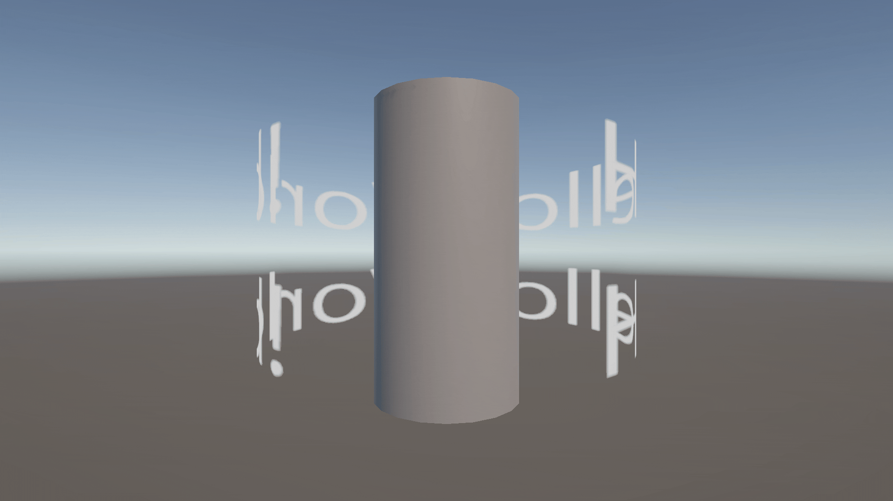
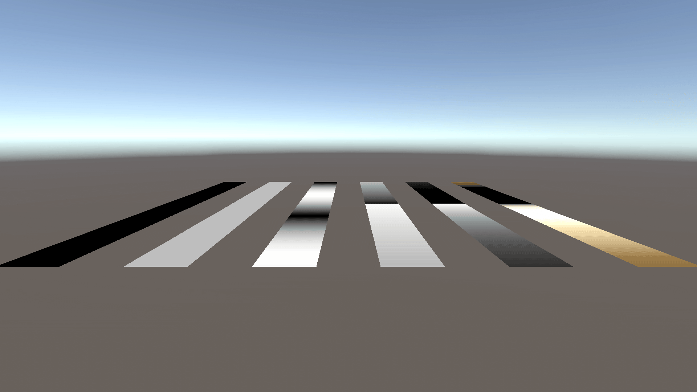
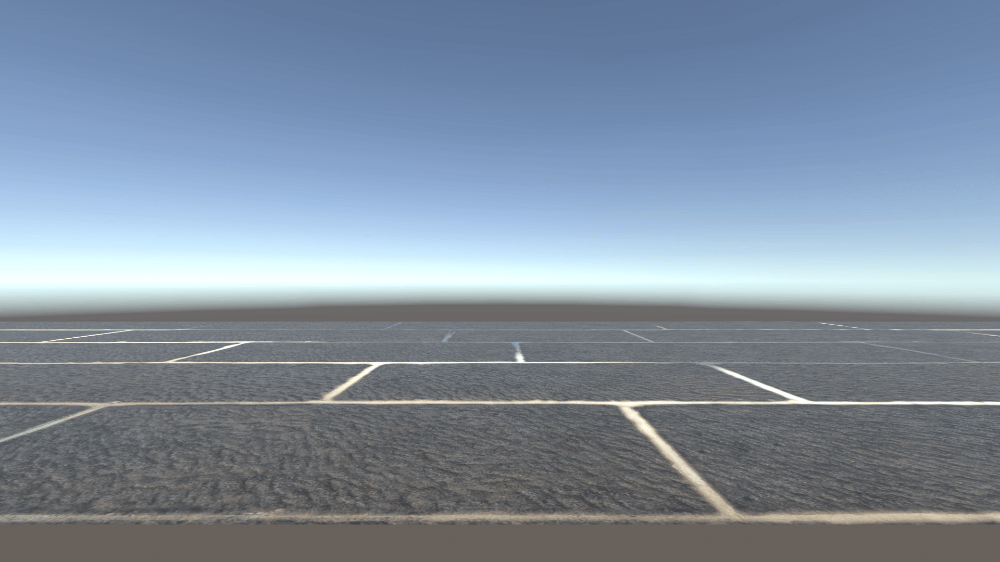
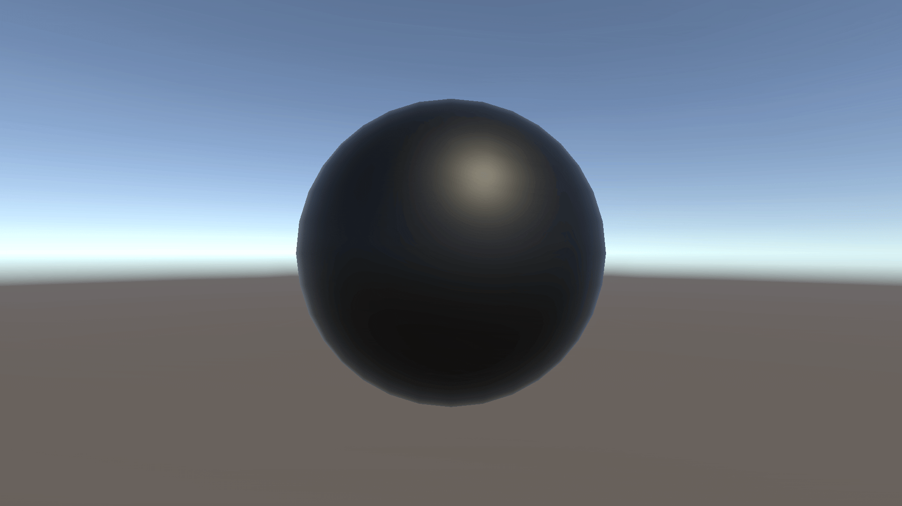

# はじめに
プログラムワークショップIVの管理用です

# 結果画像

- 工夫した点：Timeノードを利用して発光ラインが流れる表現を作成し、複数の色のラインを組み合わせることで動きが分かりやすくなるよう工夫しました。

# 進め方

- 本リポジトリをforkしてください
- fork先のリポジトリを更新してください
- Unityのプロジェクトをsrc内で進めてください
- 結果を画面キャプチャして、画像としてリポジトリに追加して、上記のリンクから見られるようにしてください
- 完成したら本リポジトリのmainブランチにpull requestを投げてください
